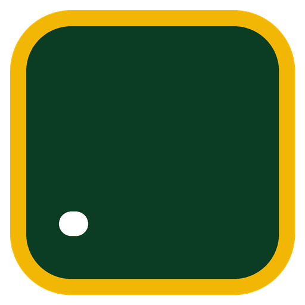

# Math 9 Learning Hub

**Mathematics 9 class site for all Grade 9 learners of Siay National High School, Siay, Zamboanga Sibugay.**
School Year 2026–2027 · Term 2 · Version 1.1 · Last updated November 4, 2026

**Live site:** https://benitezjomar22-jpg.github.io/Math9-LearningHub/

The hub is a supplementary learning platform. Each week has study-ahead material, lessons with illustrations and worked examples, Easy/Average/Difficult practice, a five-item practice Check, and a written reflection. Lessons are adapted from the Term 2 lesson plans (LPTs) and slides used by Grade 9 Mathematics teachers.

Maintained by **Jomar B. Siarez**, Teacher I, Mathematics 9.

---

## For learners

1. Open **This week** for the current lessons, or **Next week** to study ahead.
2. In each week: **Study ahead → Learn → Practice → Check → Reflect**.
3. The Check has five questions. Getting at least 4 right meets the **weekly practice target**. It is practice, not a final grade.
4. No internet at home? On the home page, tap **Download offline copy** while you have data or Wi-Fi, then open the file from **Files → Downloads** with Chrome.

## Privacy

- No login, no database, no tracking.
- Check scores, self-ratings, and reflections are saved **only in the learner's browser** (localStorage). They are never sent to a server or to the teacher.
- On shared phones or school computers, learners should tap **Clear my progress** before leaving.
- Loading the site makes ordinary web requests to GitHub Pages (the host) and Google Fonts (lettering). Supplementary video links open Khan Academy or YouTube, which have their own privacy policies.

---

## Weekly update (teacher checklist)

1. Open **`config.js`** and change:
   - `currentWeek` to the week your classes are on;
   - `lastUpdated` to today's date.
   The home page, the **This week / Next week** links, and the week map all follow this setting.
2. If lesson dates change, edit `dates` near the top of that week's file (for example, `week08.js`).
3. To add a new week's full lessons, edit its file (for example, `week08.js`) and set `status: "ready"`.
4. Rebuild the offline copy: `python build-offline.py` (or ask for an updated `math9-hub-offline.html`).
5. Upload the changed files to GitHub (**Add file → Upload files**). Files with the same name are replaced.

## Files

All files sit together at the top level of the repository, so they can be uploaded with GitHub's **Upload files** button in one step.

| File | What it is |
| --- | --- |
| `index.html` | Page shell: header, skip link, list of scripts |
| `config.js` | **Site settings:** current week, school year, last updated |
| `week01.js` … `week10.js` | One lesson file per week |
| `styles.css` | All styles (light and dark mode) |
| `helpers.js` | Shared helpers: tables of values, concept tables, proofs, video entries |
| `figures.js` | Diagrams and interactive graphs |
| `progress.js` | Saving on this device; "Clear my progress" |
| `activities.js` | Lessons, practice, Check, reflection, sorting tasks |
| `navigation.js` | This week / Next week links, week map, page routing |
| `app.js` | Home and week pages; start-up |
| `siay-nhs-logo.png`, `hub-icon-*.png`, `hub-logo-animated.gif` | Images |
| `math9-hub-offline.html` | One-file copy that works without internet |
| `build-offline.py` | Rebuilds the offline copy |

## Writing a lesson

Each lesson in `weekNN.js` has:

| Field | What it holds |
| --- | --- |
| `id`, `title` | Lesson number and title, e.g. `"7.1"` |
| `key` | The key idea in one or two sentences |
| `points` | Explanation paragraphs; may include `tov(...)` tables of values, `ctable(...)` concept tables, and `proof(...)` two-column proofs |
| `figure` | Name of a diagram or interactive in `figures.js` (or `"sorter"`) |
| `example` | A worked example: question and numbered steps |
| `videos` | Supplementary videos: `[vid("Title", "https://…", "Source")]`. Leave out if there is none; the page then says so plainly |

Practice items have `level` (Easy, Average, Difficult), `q`, `ans`, `unit`, `sol`, and optional `choices`. Check items have five multiple-choice questions, each tagged with the `lesson` it reviews.

## Accessibility

Skip-to-content link; keyboard focus moves to each new page heading; labelled radio groups and answer fields; reflection ratings use real radio buttons; tables use header cells; works in light and dark mode; checked at phone width (390 px) and at the equivalent of 200% zoom with no sideways scrolling of the page.

## Roadmap

- **Phase 1.1 (done in v1.1):** clearer trapezoid and kite definitions; corrected parabola description; "target reached" wording for the Check; written reflection; honest video labels with supplementary links.
- **Phase 1.2 (done in v1.1):** Clear my progress; one-setting week navigation; accessibility fixes; phone and zoom testing. Still to do: hands-on testing on learners' Android phones and school computers.
- **Phase 2:** teacher-made video lessons; randomized item banks; printable worksheets; installable offline app (caching); teacher documentation of lessons and assessments.

## Credits and AI use

Lessons are adapted from the Division LPT prototypes and the Siay NHS contextualized LPTs and slides for Mathematics 9, Term 2. Site design, interactive figures, and lesson adaptation were prepared with the assistance of Claude (Anthropic) and reviewed by the teacher, consistent with DepEd Order No. 3, s. 2026. Supplementary videos are linked from Khan Academy and from YouTube links in the Week 5 lesson plan. The Siay National High School seal is used for this school's own class site.
